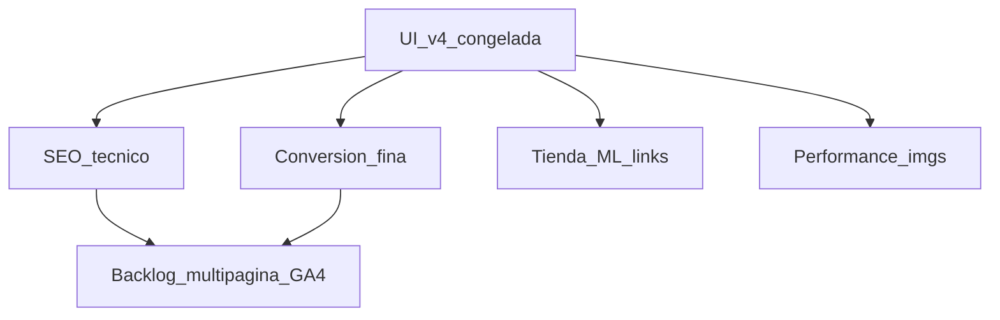

# Plan reformulado: auditoría post-UI (v4)

## Principio

La UI actual en `feat/v4` es **estable y buscada**. No se reabre:

- split marca propia / marcas que confían / bodega
- servicios en lista (sin tabs) + proceso dentro de Gin Granel/Fasón
- FAB WhatsApp, nav sin Escribinos, Tienda → `/tienda`
- tipografías (Playfair + Inter), hovers dorados, tratamiento de imágenes Capitán vs otras marcas
- stats, medallas nacionales Capitán, copy bodega Plaza de Grillos

Trabajo restante = **SEO técnico + conversión fina + datos de negocio**, sin rediseñar secciones.

## Arquitectura UI congelada

Orden home ([`app/page.tsx`](app/page.tsx)):

`Header` → Hero → Marquee → Brands → Services → Destilería → Bodega → Nosotros → FAQ → Contacto → Footer (+ WhatsApp FAB)

Nav: Marcas · Servicios (dropdown) · Destilería · Bodega · Nosotros · Contacto · Tienda (`/tienda`)

## Decisiones de negocio confirmadas

- **Teléfono / WhatsApp oficial: `+54 9 11 2285-2023`** (`wa.me/5491122852023`). Unificado en código; no volver a 2295. Footer NAP usa este número.

## Ya hecho

| Área | Estado |
| --- | --- |
| Formulario contacto + Supabase | Hecho |
| Schema Organization + llms/AEO | Hecho |
| Teléfono unificado a **+54 9 11 2285-2023** (confirmado) | Hecho ([`lib/contact.ts`](lib/contact.ts), SEO/llms) |
| WhatsApp FAB; sin CTA WA texto en hero | Hecho |
| Tienda interna `/tienda` + Comprar (placeholder ML) | Hecho UI |
| Brands split + 3 medallas nacionales + assets awards | Hecho |
| Bodega `#bodega` + copy 2015 / Valle de Uco | Hecho |
| Servicios stacked + proceso nested + hover accent | Hecho |
| DESIGN.md tipografías (2 familias) | Hecho |
| SectionNav duplicada eliminada | Hecho |

## Fase A: SEO técnico

1. [`public/sitemap.xml`](public/sitemap.xml) con `/` y `/tienda`
2. [`public/robots.txt`](public/robots.txt): `Sitemap:` (+ Schemamap existente)
3. OG / Twitter / canonical + imagen OG en [`app/layout.tsx`](app/layout.tsx)
4. Meta title/description más B2B en i18n (sin cambiar H1 visual)
5. FAQ **visible** `#faq` alineada al FAQPage JSON-LD; JSON-LD solo en home (no en `/tienda`)
6. Footer: email + NAP institucional (razón social / planta / WA)

## Fase B: conversión (sin rediseño)

1. CTAs por servicio: WhatsApp prellenado o modal con motivo
2. Hero: “Cotizá tu proyecto” / “Conocé nuestros servicios”
3. Formulario: campos opcionales volumen + mensaje (migración Supabase)

## Fase C: tienda / datos

1. Reemplazar `buyUrl` placeholder en [`lib/store/products.ts`](lib/store/products.ts) por links ML reales **cuando el negocio los provea** — estructura lista; URLs aún placeholder
2. Imagen Ribecky: `ribecky.jpg` — OK

## Fase D: performance

1. `next/image` activo (sin `images.unoptimized`)
2. Priority en hero; WebP en still / detail / gauge / us
3. Formulario: campos volumen + mensaje — migración en [`supabase/migrations/20260807120000_contact_submissions_volumen_mensaje.sql`](supabase/migrations/20260807120000_contact_submissions_volumen_mensaje.sql) (aplicar en Supabase si aún no está)

## Fuera de scope

Multipágina de servicios, blog, GTM/GA4/Search Console, Google Ads, PR/GMB.

## Dependencias de negocio

- Links Mercado Libre por producto (pendiente de negocio)
- Respuestas FAQ con mínimos/plazos específicos (si se quieren publicar números duros)
- Confirmación si el footer debe mostrar CUIT / horarios
